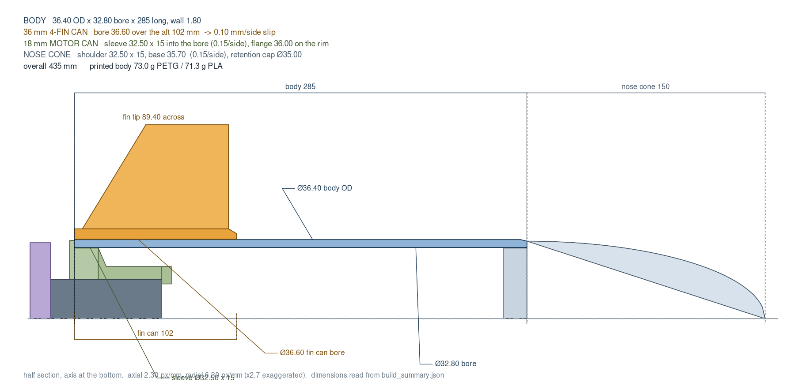

# 36 mm rocket body — the airframe that joins the 18 mm motor can and the 36 mm 4-fin can

The body that makes `18mm-motor-can` and `36mm-fin-can` one rocket. The 18 mm
motor can glues **into** its aft end; the 36 mm 4-fin can slips **over** the aft
102 mm; the printed nose cone's shoulder slides into its forward end. End to end
that is a 435 mm rocket on a 36 mm airframe.

Nothing here is a matter of taste: the two existing printed parts fix the
diameter from both sides, and everything else follows.

**Rev C (2026-11-24): OD 36.30 → 36.40 mm.** The printed Rev B body still felt
slightly loose in the fin can, so this closes another 0.10 mm — again on the
outside only, so the wall went 1.75 → 1.80 mm and the bore stayed at 32.80. The
gauge and the launch lug (`36mm-launch-lug`) both track it. Three consequences
to know before printing:

* the fin can now has **0.10 mm/side** slip — the floor of the allowed range
  (`validate()` refuses below 0.10), so dry-fit Rev C in the fin can before you
  commit a 285 mm print. **Rev C is the widest this body can go**: the fin can's
  36.60 bore leaves 0.20 mm total, and anything more than 36.40 seizes;
* the 18 mm motor can's 36.00 flange is now 0.40 mm inside the body's OD, so the
  aft rim stands 0.20 mm proud of the flange, and the forward fairing to the nose
  cone's 35.70 base is a 0.35 mm radial step over 4 mm (5.0°, was 4.3° on Rev B,
  2.1° on Rev A);
* the printed body is 2 g heavier: 69 g PLA / 70.7 g PETG.

Rev A (36.00), Rev B (36.30) and Rev C (36.40) are told apart with calipers on
the OD. **Rev A and Rev B are superseded** — do not mix them with Rev C parts.

**Rev B (2026-11-24): OD 36.00 → 36.30 mm.** +0.30 mm on the outside only, so
the wall went 1.60 → 1.75 mm and the bore stayed at 32.80. Superseded by Rev C.



## Split variant: two halves with a keyed joint + M3 mounting pads

`build_body_36mm_split.py` builds the same airframe as **two printable halves**
that glue together, so the 285 mm tube no longer needs a tall, tippy print:

| part | z range | what's on it |
|---|---|---|
| `body36_aft.stl` | 0 – 142.5 mm | motor can sleeve, fin can register, aft register taper, 4 male keys |
| `body36_fwd.stl` | 142.5 – 285 mm | female register, 4 keyways, **4 internal M3 mounting pads**, cord anchor seat, nose shoulder + nose fairing |

**The joint (z = 142.5 mm).** A stepped register on the **outside** of the wall,
so the bore stays a continuous 32.80 mm — the motor can's sleeve, the nose cone's
shoulder and the ejection charge all pass through untouched.

* aft half: OD tapers 36.40 → 36.25 mm over the last 8 mm
* fwd half: OD tapers 36.55 → 36.40 mm over the first 8 mm
* at the joint plane the two faces butt with a **0.15 mm glue gap** per side
* **4 keys** at 0/90/180/270°, 4 mm wide × 1.2 mm deep × 5 mm tall, rounded tops —
  male pegs on the aft face, matching pockets in the fwd face, so the halves can
  only go together one way
* joint interference measured at **0.000000 mm³**

**The mounting pads (the "inner diameter" mounting points).** Four pads on the
**bore wall** of the forward half, at 45/135/225/315° (offset from the keys),
z = 154–168 mm:

* 30° arc (~8.6 mm wide) × **5.0 mm radial protrusion** × 14 mm long
* each with an axial **M3 self-tapping pilot: 2.7 mm dia**, drilled from the aft
  face, ~1 mm of material either side of the hole
* free bore at the pads is **22.8 mm** (32.80 between them) — enough for gas and a
  packed chute, and the price of putting the pads inside
* their aft faces give you a flat 4-point mounting plane for a bulkhead or a
  shock-cord plate, and a plate bolted there also backs up the glued joint

Print the two halves in the modelled orientation (aft/register face down for the
forward half, aft rim down for the aft half). No supports: the pads present a
~6 × 5 mm horizontal underside each, which bridges.

## The three fits

| mating part | what it needs | what this body gives | clearance |
|---|---|---|---|
| 36 mm 4-fin can (`36mm-fin-can`) | bore 36.60 over a **36.40 OD** tube | OD 36.40 | **0.10 mm/side** slip |
| 18 mm motor can (`18mm-motor-can`) | 32.50 × 15 sleeve into the tube **and** a 36.00 flange on the rim | bore 32.80, OD 36.40 | **0.15 mm/side**, flange 0.40 mm inside the OD |
| printed nose cone (v1) | 32.50 × 15 shoulder, 35.70 base | bore 32.80, forward rim faired to 35.70 | **0.15 mm/side** |
| 18 mm motor can's retainer cap | OD 35.00, it must be turnable inside the fin can's mouth | fin can bore 36.60 | 0.80 mm |

That table is the whole design. The bore is not free: 32.80 is the *narrowest*
bore the motor can's sleeve and the nose cone's shoulder both still enter
(0.15 mm/side), and 36.40 OD is the *widest* the fin can still slips over at the
0.10/side floor (`fincan_bore` 36.60 − 2 × 0.10). Subtract them and the wall is
**1.80 mm** — with the bore pinned by the can and the nose cone, and the OD
pinned by the fin can, it has no choice. Rev C sits exactly on that ceiling; a
tenth of a millimetre more and `validate()` refuses to build.

The 18 mm motor can's flange is 36.00 against this body's 36.40 OD. It is still
the thrust path — the flange butts the aft rim, so the motor pushes the rim in
compression instead of pulling on four square millimetres of glue — but on Rev C
the flange covers less of the rim's width: it presses on the annulus 32.80 →
36.00 (1.60 mm wide, ~178 mm² of contact) and the outer 0.20 mm ring of the rim
is left uncovered. The rim face itself is 1.80 mm wide by ~113 mm around.

## Read this before you print it: mass

| | mass |
|---|---|
| printed body, 1.80 mm solid wall (this file) | **69 g PLA / 70.7 g PETG** |
| same tube in cardboard, 285 mm | ~20-22 g |
| nose cone as printed | 22.6 g |
| 36 mm fin can (PETG) | ~44 g |
| 18 mm motor can + cap (PETG) | 38.1 g |
| Estes C6-5 | 24 g |
| **flying mass with the printed body** | **~199 g** |
| **Estes C6-5 maximum liftoff weight** | **113 g** |

The wall is 1.80 mm, which is four 0.45 mm perimeters or 4.5 × 0.4 mm lines —
the slicer will gap-fill the remainder — so **0 % infill does not help**. A
printed body of this size is a solid-wall tube and there is no infill trick that
changes it. At ~199 g the printed version is 176 % of the C6-5 limit and will
not fly safely; even swapping in a cardboard tube leaves ~151 g, still over.

So be clear about what this part is for:

* it is a **fit-and-assembly master**: print it, glue the two cans on, and you
  have a complete rocket to mock up, load and photograph;
* it is **not** a C6-5 airframe. That rocket needs a motor with more thrust than
  a C6 (check the motor's own published maximum liftoff weight against the
  ~160-200 g you actually weigh), or a lighter airframe.

If you want to fly it on a C6, use the cardboard tube instead. The bore/OD pair
in the table above is the spec to buy or roll to (36.40 OD, 32.80 ID, 1.80 wall,
285 long) — the two printed cans and the nose cone drop straight onto it, and
this repo already carries the fit gauge to check the tube in your hand before
you commit a 285 mm cut.

## Files

| file | what |
|---|---|
| `build_body_36mm.py` | the source of truth: parametric, validates, builds, verifies against both mating parts, exports |
| `body36_aft.stl` | aft half, print orientation — aft face at z=0, 142.5 mm tall |
| `body36_fwd.stl` | forward half with the 4 mounting pads — print orientation, register face down, 142.5 mm tall |
| `body36_cord_anchor.stl` | shock-cord anchor, print upright as modelled (2.4 g) |
| `body36_gauge.stl` | 20 mm test coupon: one end has the aft rim, the other the forward rim. 4.3 g, ~20 min — **print this first** |
| `body36.step` | all three parts, design orientation (aft face at z=0, +Z toward the nose) |
| `body36.FCStd` | the FreeCAD document |
| `build_summary.json` | every dimension, every check result and the sha256 of each STL from the last build |
| `build.sh` / `check_build.sh` | rebuild + report; and "are the committed STLs what the script produces?" |
| `preview_body.py` / `preview_body.png`, `interface_section.py` / `.svg` / `.png` | the render sheet and the dimensioned fit drawing (both read the built model) |

Rebuild:

```bash
cd ~/Documents/FreeCad-Docs/36mm-rocket-body
./build.sh
```

`check_build.sh` is the one worth knowing: the STLs are committed but generated,
so it rebuilds and compares sha256. `IN SYNC` means the printable files are
exactly what the script produces; `OUT OF SYNC` prints both hashes. The meshes
are byte-reproducible across rebuilds (verified — two consecutive builds give
identical hashes), which is what makes the check meaningful.

## Geometry (design orientation, aft face at z=0, +Z toward the nose)

| z (mm) | feature | OD / bore |
|---|---|---|
| 0 | **aft rim** — the motor can's flange butts here, the fin can slides on here | OD 36.40 / bore 32.80, 0.4 mm OD chamfer |
| 0 – 15 | where the motor can's 32.5 sleeve is glued in | bore 32.80 |
| 0 – 102 | covered by the 36 mm fin can | OD 36.40 |
| 0 – 76 | inside: the motor can's block ends 76 mm in | — |
| 108 – 138 | cord anchor glues in (see Recovery) | bore 32.80, anchor throat 27.70 |
| 134.5 – 142.5 | **aft half ends**: register taper 36.40 → 36.25 mm, 4 male keys on the end face | OD 36.40 → 36.25 |
| 142.5 | **glue joint** (split variant only) | 0.15 mm glue gap per side |
| 142.5 – 150.5 | **fwd half starts**: register taper 36.55 → 36.40 mm, 4 keyways in the end face | OD 36.55 → 36.40 |
| 154 – 168 | **4 mounting pads on the bore wall** (fwd half), M3 pilots | free bore 22.8 mm at the pads |
| 270 – 285 | nose cone shoulder bay (fits the 32.5 × 15 shoulder) | bore 32.80 |
| 281 – 285 | forward rim fairing 36.40 → 35.70 to meet the nose cone's base | rim wall 1.45 |
| 285 | forward rim, 0.6 mm bore lead-in | OD 35.70 |

Overall 285 mm, 36.40 OD, 32.80 bore, 1.80 wall. Volume 57.5 cm³ with the split
register and four mounting pads (55.7 cm³ without them), area 622.4 cm².

## Printing

* **Body (split variant, two parts):** upright in the modelled orientation,
  **no supports anywhere**. 0.2 mm layers, 4 perimeters (the wall is four lines
  plus a gap-fill sliver — that is the part), 0 % infill, 4-5 top/bottom layers,
  5 mm brim (bed contact is a 1.80 mm annulus, 150.4 mm² per half). ~2 h a half.
  PETG for preference, or ASA/ABS: the aft 100 mm wraps the motor.
  The forward half goes register-face down — its bore opening is on the bed, so
  the four mounting pads grow upwards from the wall with a ~6 × 5 mm underside
  each, which bridges.
* **Print the gauge first.** 20 minutes and 4.3 g tells you whether the fin can
  slips on and whether the motor can's sleeve and the nose shoulder enter,
  before you spend hours on the body. If the gauge is wrong, the fix is one
  number (`body_od` or `body_bore`) and a rebuild, not a reprint.
* **Cord anchor:** upright as modelled, 2.4 mm walls, 20 % infill, brim.
* Vertical print = hoop strength. The extrusion runs circumferentially, so the
  body's ejection-pressure load is carried **in-layer**, not across layer bonds.
  That is the good direction, and it is why a printed tube is acceptable as a
  pressure vessel here even though it is a poor material choice for mass.

## Fitting and assembly

1. **Gauge.** It should slide over the fin can's bore and accept the motor can's
   sleeve and the nose cone's shoulder. If any are tight, stop and adjust.
2. **Motor can.** Dry-fit first: the sleeve enters the aft end and the 36.00
   flange lands on the rim. Then epoxy (5-minute) the sleeve into the bore —
   roughen both surfaces. Do **not** glue the flange face; it is the thrust
   seat. The motor can must go in **before** the fin can, or you cannot reach
   the joint.
3. **Fin can.** Slides over the aft 102 mm from the aft end, aft face flush with
   the body's aft rim. On Rev C that is only **0.10 mm/side** — a firm push fit,
   the tightest this can be and still go on. Check the body actually mics 36.40
   first (the gauge did that), sand the tube lightly if it drags, epoxy it. If a
   printed Rev C still feels loose, the fin can's bore is the part to re-mic —
   there is no room to widen the body further.
4. **Joint (split variant).** Dry-fit the halves: the 4 keys should drop into
   their pockets with no force and the register faces should close to a
   0.15 mm line all round. Epoxy both register faces, push together **rotating
   until the keys seat**, and hold until green. Check the bore with the gauge —
   the joint must not leave a lip inside. The four M3 pads in the forward half
   are at z=154–168 mm, forward of the joint, so a plate screwed onto them also
   bridges the glue line.
5. **Cord anchor.** Glue at 108 mm up the tube (its aft face), 0.15 mm/side glue
   gap. Thread the shock cord in one 4 mm slot and out the other, over the 8 mm
   bridge, and knot it aft of the anchor. The cord then runs forward through the
   anchor's 27.70 mm throat into the chute bay.
6. **Recovery.** Chute and wadding in the bay 140 → 270 mm, nose cone friction
   fit on its 32.5 × 15 shoulder. The bore is unbroken from the motor can's
   block at 76 mm all the way to the nose, so the ejection charge has a clear
   path (checked: min free diameter 32.80 mm through the whole bay).
7. Tape or glue the cord anchor before the first flight, and pull-test it — it
   is the only thing holding the two halves together.

The body wall is the airframe's airtight surface (there is no cardboard seam to
leak), which is what the ejection charge needs to push the nose off.

## Changing any dimension

Edit the `P` dict at the top of `build_body_36mm.py` and re-run `./build.sh`
(~30 s). `validate()` runs first and refuses to build a combination that would
not fit, printing why and exporting nothing — a bore that the sleeve cannot
enter, a fin can that would seize, a wall too thin to print, a body too long for
the printer, a cord slot too close to its neighbour.

The interface numbers on the right-hand side of `P` (`can_sleeve_d`,
`fincan_bore`, `nose_shoulder_d`, …) are **measurements of the other repos**.
They are there so the fit checks know what they are checking against; if you
re-dimension the fin can, change `fincan_bore` here too and the checks will tell
you whether the body still works.

### If you only have the 35.0 mm v1 tube

Then this body does not apply as drawn: the fin can was designed for a 36.00 OD
tube and its 36.60 bore leaves 0.80 mm/side on a 35.0 tube — glueable but sloppy,
and it changes the forward fairing's step. Two honest options, in order of
preference:

1. get the 36.40 OD / 32.80 bore tube (the spec above), or print this body;
2. re-dimension the fin can (`build_fincan_36mm.py`: `tube_od` 36.0 → 35.0)
   and print a new can. The motor can and nose cone already fit that tube.

### Rev history

| rev | OD | bore | wall | note |
|---|---|---|---|---|
| A | 36.00 | 32.80 | 1.60 | as first printed; 0.30 mm/side fin-can slip |
| B | 36.30 | 32.80 | 1.75 | +0.30 mm outside for the printed tube's fit; fin-can slip 0.15/side. Gauge, STLs and the launch lug all rebuilt |
| D | 36.40 | 32.80 | 1.80 | **split build**: two halves, keyed glue joint at z=142.5, 4 M3 mounting pads on the bore wall (z=154–168). Adds ~1.8 cm³ |
| **C** | **36.40** | 32.80 | **1.80** | +0.10 mm outside after the printed Rev B still felt loose in the fin can; slip now 0.10/side, the hard ceiling. Gauge, STLs and the launch lug rebuilt |

## What was verified

30 checks, all passing on every build (`build_summary.json` carries them all
with their details). The interesting ones:

* **volume exact** — 55683.1 mm³ expected from the revolved tube + frustum minus
  the bore, against 55683.1 measured, **+0.00000 %**;
* **OD and bore measured off the built solid**, by bisection at five heights:
  36.400 and 32.800 everywhere, including the 5.0° forward fairing
  (35.850 at z=284, 35.730 at 284.8) — the STL cannot show a taper, the solid
  can;
* **fin can fit, full size**: a 36.60 bore × 102 dummy slides over with
  **0.000000 mm³** interference, 0.10 mm/side, and the test is live — a bore
  0.1 mm tight collides for 452.17 mm³;
* **motor can fit, full size**: the 32.50 × 15 sleeve enters with **0.000000
  mm³**, a 0.5 mm oversize sleeve collides for 155.04 mm³, and the 36.00 flange
  spans z −3.00…0.00, i.e. its forward face is exactly on the rim;
* **nose cone fit**: the 32.50 × 15 shoulder enters with **0.000000 mm³**, a
  0.5 mm oversize shoulder collides for 149.35 mm³;
* **charge path**: a 1 mm scan of the bore from the motor can's block (76 mm) to
  the nose bay (270 mm) never finds material — min free diameter 32.80;
* **split joint**: both halves are one valid solid each, z bounds 0–142.5 and
  142.5–285.0 exactly, and the interference between them is **0.000000 mm³**;
* **keys**: 4 male pegs on the aft face, 4 matching pockets in the forward face,
  no interference, and they are the only things that can align the halves
  rotationally;
* **mounting pads**: 4 pads, free bore **22.8 mm** at each, all four M3 pilots
  open (probed inside the hole), ~1 mm of material either side, clear of the
  register at z=150.5 and of the anchor at z=138;
* **printability from the solid's faces, not assumed**: the body has exactly
  two downward-facing faces (the bed ring; 150.4 mm² of contact) and **no
  off-bed downward face at all**, so no supports. The cord anchor's only
  shallow faces are the two cord-slot roofs, 9.63 mm² each, which bridge.

## Build notes worth keeping

Traps that cost time here, all now handled in the script:

* **A tube is an annulus, so monotone bisection lies.** Probing the OD by
  bisecting 0 → OD+6 returns **0**: the axis is *outside* the solid too, so the
  search walks back down into the bore and never finds material. Start the
  bisection inside the wall instead. (`bore_r_at` is fine from the axis — the
  bore is monotone inward — which is why the bore read correctly while the OD
  read 0.000 and looked like a broken model.)
* **FreeCAD's console runner calls `_exit` on `SystemExit`, throwing away
  buffered stdout.** A rejected parameter set printed *nothing at all* and just
  exited 1, which reads exactly like FreeCAD failing to start. `sys.stdout.flush()`
  before every `sys.exit()`.
* **Radius vs diameter in the validator.** `nose_base_d` is a diameter; mixing it
  with `bore` reported a −14.95 mm rim wall. The validator is the last place to
  be sloppy — it is what you trust when you edit a number.
* **A glue-in part is not in the solid.** The cord anchor is a *separate* part,
  so a bore scan of the body correctly shows a clear 32.80 throat and proves
  nothing about the anchor; its throat has to be checked arithmetically from its
  own parameters.
* **A cord slot is a through-window, and its roof is a 0° ledge.** That is a
  bridge, not a support: 9.63 mm² over a 4 mm span. The printability check takes
  an explicit bridge allowance rather than failing the part or silently
  ignoring ledges.
* **Stale bytecode** — `FreeCAD --console script.py` imports the script, so a
  same-second, same-size edit can run old code. `build.sh` deletes
  `__pycache__` before every build.

## Licence

None chosen yet — a repository with no licence is all rights reserved. The code
is the author's own. If this ever goes public, pick a licence for the design
files first: CC BY-NC-SA 4.0 to keep it non-commercial and share-alike, or
CERN-OHL-S / CC BY-SA 4.0 to allow commercial use.
